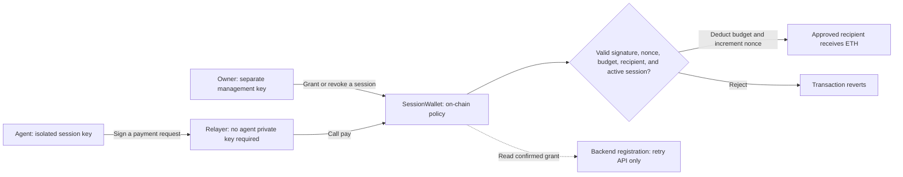

# ERC-4337 AI Agent Wallet Guardrails (Reference Patterns)

Reference patterns and security checklist for giving autonomous AI agents bounded EVM payment permissions without handing over a master private key.

[简体中文](README.zh-CN.md)

## Why EOAs Break for Autonomous Agents
If an LLM agent holds a raw EOA private key, a single prompt injection or tool-calling bug drains the entire wallet. Putting spending rules only inside your backend API doesn't protect you if the signing key itself leaks.

## Core Guardrail Architecture
1. **Key Separation**: The owner reviews policy parameters (asset, cap, recipient scope, expiry) and authorizes only the agent's public address. The agent signs inside its own isolated Node.js runtime.
2. **Contract-Enforced Validation**: Spending caps and expiry checks happen on-chain during ERC-4337 `UserOperation` validation—not in prompt instructions.
3. **Revocation Blocks Pre-Signed Ops**: When the owner revokes a session, even a `UserOperation` signed before revocation is rejected by the Guard during bundler validation.
4. **Decoupled On-Chain vs. API Sync**: Separate chain confirmation from backend registration so a transient API error retries registration without sending duplicate on-chain grant transactions.
5. **Mandatory Key Rotation**: Re-authorizing after revocation requires a fresh agent public key to prevent stale session replay.

## Foundry Demo Architecture

Run `forge test -vv` from the repository root. The demo validates and executes payments in a single `pay` call; it does not implement ERC-4337 `EntryPoint`, `validateUserOp`, or backend registration. The dashed line shows the intended backend integration, not demo behavior. See the [Foundry demo guide](docs/foundry-demo.md).

## Full Source Code & Custom Integration
Need the complete working stack (**Solidity + ERC-4337 + Foundry + Next.js + viem**) with owner approval UI, session dashboard, and custom integration into your agent runtime?

- Product architecture & walkthrough: [Agent Wallet Guard — Fone (0xF1)](https://fone.cc/products/agent-wallet-guard/)
- Permission & execution flow: [Permissions & Execution Spec](https://fone.cc/products/agent-wallet-guard/permissions/)
- Custom Web3 & AI Agent engineering: [AI Agent Development Services](https://fone.cc/services/ai-agent-development/)
