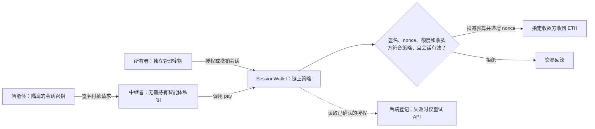

# ERC-4337 AI 智能体钱包安全护栏（参考设计）

[English](README.md)

本文提供参考设计和安全检查清单，帮助你在不交出主私钥的前提下，为自主 AI 智能体授予受限的 EVM 支付权限。

## 为什么普通外部账户（EOA）不适合自主智能体

如果把 EOA 私钥直接交给大语言模型（LLM）智能体，一次提示词注入或工具调用错误就可能耗尽钱包资金。如果签名私钥已经泄露，只在后端 API 中设置支出规则无法保护资金。

## 核心安全架构

1. **密钥隔离**：钱包所有者审核策略参数（资产、额度上限、收款方范围和到期时间），只授权智能体的公开地址。智能体在隔离的 Node.js 运行环境中签名。
2. **合约强制校验**：额度和有效期由合约在 ERC-4337 `UserOperation` 验证阶段检查，不依赖提示词约束。
3. **撤销使预签名操作失效**：会话撤销生效后，即使 `UserOperation` 在撤销前已经签名，也会在 Bundler 验证时被护栏合约拒绝。
4. **链上确认与 API 登记解耦**：链上授权确认后再进行后端登记。遇到暂时性 API 错误时，只重试登记，不重复发送链上授权交易。
5. **强制轮换密钥**：撤销后重新授权必须使用新的智能体密钥对应的地址，防止旧会话的签名被重放。

## Foundry 示例架构

在仓库根目录运行 `forge test -vv`。示例在一次 `pay` 调用中完成校验与付款，不实现 ERC-4337 `EntryPoint`、`validateUserOp` 或后端登记。虚线表示预期的后端集成，不是示例的实际行为。详见 [Foundry 示例说明](docs/foundry-demo.md)。

## 完整源码与定制集成

如果你需要完整技术栈（**Solidity + ERC-4337 + Foundry + Next.js + viem**），包括所有者审批界面、会话管理面板，以及与智能体运行环境的定制集成，可参阅：

- 产品架构与操作指南：[Agent Wallet Guard — Fone (0xF1)](https://fone.cc/products/agent-wallet-guard/)
- 权限与执行流程：[Permissions & Execution Spec](https://fone.cc/products/agent-wallet-guard/permissions/)
- Web3 与 AI 智能体定制开发：[AI Agent Development Services](https://fone.cc/services/ai-agent-development/)
