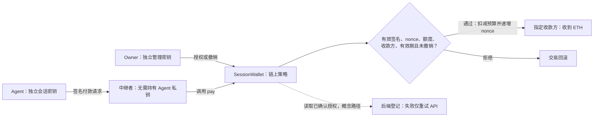

# Minimal Foundry Demo / 极简验证示例

安装 [Foundry](https://getfoundry.sh/) 后，在仓库根目录运行：

```bash
forge test -vv
```

无需安装 `forge-std`，也无需 RPC、私钥配置或链上部署。首次运行时，Foundry 会按 `foundry.toml` 获取 Solidity 0.8.30（如尚未缓存）。

- [SessionWallet.sol](../src/SessionWallet.sol)：Owner 授予独立的 Agent 地址一笔可分次使用的 ETH 预算，并指定唯一收款地址与到期时间。任何中继者都可以提交签名；合约在同一笔交易里验证签名、策略和 nonce，扣减预算后付款。
- [SessionWallet.t.sol](../test/SessionWallet.t.sol)：验证正常付款及累计超额、非许可收款方、错误签名、nonce 重放、到期边界、撤销前已签名的付款失效、旧地址不能重新授权，以及只有 Owner 能管理会话。

## 架构图



**与 ERC-4337 的对应关系：** 图中 `pay` 把策略验证和执行放在同一次调用中，便于本地验证；它不是 `validateUserOp`，中继者也不是 ERC-4337 Bundler。实际集成时，由 Bundler 提交 `UserOperation` 给 EntryPoint，再由账户在 `validateUserOp` 阶段应用对应策略。撤销交易必须先于付款生效，不能取消已经执行的付款。后端登记仅展示职责边界，未在示例中实现；登记失败时应依据已确认的授权重试 API，而不是重新发链上交易。

> 此合约仅用于本地教学，不是完整的 ERC-4337 账户，也没有 Owner 提款或恢复路径，请勿部署并存入真实资金。
